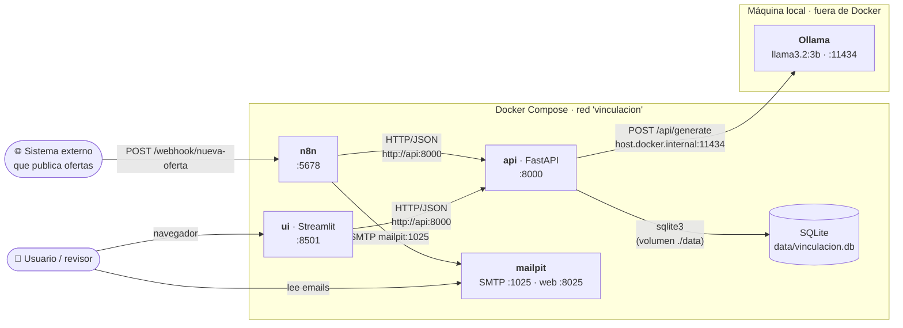
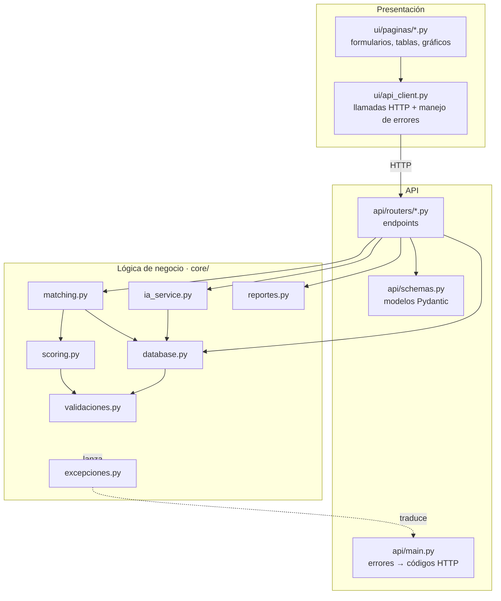
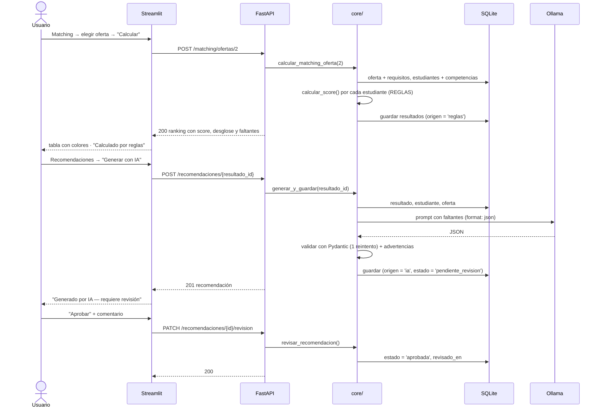
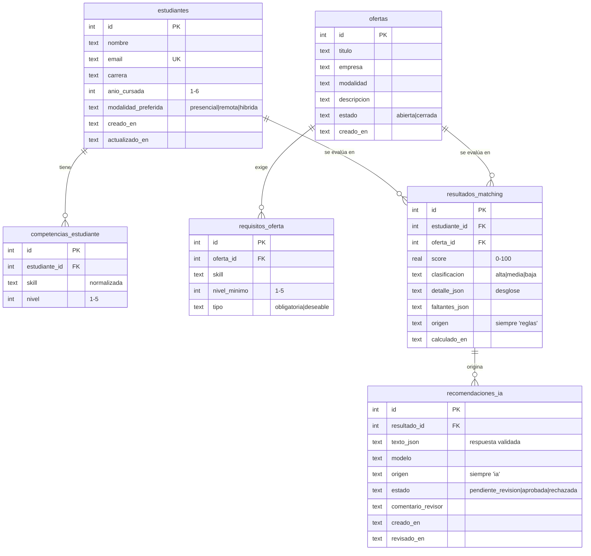
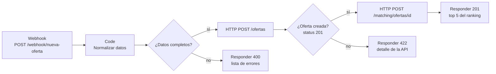
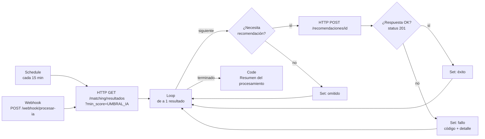
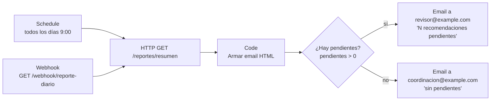
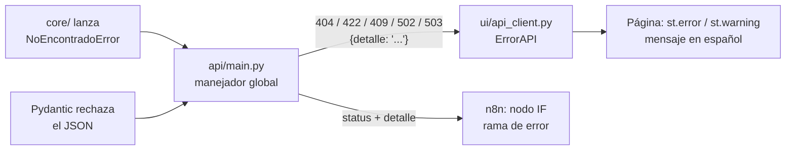

# Arquitectura del sistema

## 1. Vista general

**Ideas clave**

- **Una sola puerta de entrada a los datos: la API.** La interfaz y n8n nunca tocan la base;
  todo pasa por endpoints HTTP con JSON. Así las validaciones y reglas están en un solo lugar.
- **La lógica vive en `core/`**, en funciones Python puras que no conocen FastAPI ni Streamlit.
  Los routers de la API solo validan la forma del JSON y llaman a `core/`.
- **Reglas e IA están separadas.** El score se calcula con reglas (`core/scoring.py`); la IA
  (`core/ia_service.py`) solo recibe el resultado y redacta recomendaciones.
- **Ollama corre fuera de Docker** (la consigna no obliga a contenerizar el modelo y así
  aprovecha mejor los recursos de la máquina). La API lo alcanza con `host.docker.internal`.

## 2. Capas del código

| Capa | Responsabilidad | No hace |
|---|---|---|
| `ui/` | Mostrar datos y formularios, traducir errores a mensajes para el usuario | No accede a la base ni calcula nada |
| `api/` | Recibir/validar JSON, elegir el código HTTP, documentar en `/docs` | No tiene reglas de negocio |
| `core/` | Validar, normalizar, calcular el score, hablar con la base y con Ollama | No sabe de HTTP ni de Streamlit |

## 3. Recorrido de los datos (proceso principal)

## 4. Modelo de datos

- `UNIQUE(estudiante_id, oferta_id)` en `resultados_matching`: recalcular **actualiza** la fila.
- `ON DELETE CASCADE`: al borrar un estudiante u oferta se borran sus resultados y recomendaciones.
- Las columnas `origen` tienen un `CHECK` que impide mezclar: un resultado solo puede ser
  `'reglas'` y una recomendación solo `'ia'`.
- Las skills se guardan normalizadas (minúsculas, sin tildes) para poder compararlas.

## 5. Puertos y comunicación

| Origen → Destino | Cómo | Dirección usada |
|---|---|---|
| Navegador → Interfaz | HTTP | http://localhost:8501 |
| Navegador → API (Swagger) | HTTP | http://localhost:8000/docs |
| Navegador → n8n | HTTP | http://localhost:5678 |
| Navegador → Mailpit | HTTP | http://localhost:8025 |
| Interfaz → API | HTTP/JSON (`requests`) | `http://api:8000` (Docker) · `http://localhost:8000` (local) |
| n8n → API | Nodo HTTP Request | `{{ $env.API_URL }}` = `http://api:8000` |
| n8n → Mailpit | Nodo Send Email (SMTP) | `mailpit:1025` |
| API → Ollama | HTTP/JSON (`requests`) | `http://host.docker.internal:11434` (Docker) · `http://localhost:11434` (local) |
| API → SQLite | `sqlite3` | `/app/data/vinculacion.db` = `./data/vinculacion.db` del proyecto |

Dentro de Docker los contenedores se llaman por el **nombre del servicio** (`api`, `mailpit`)
porque comparten la red `vinculacion`. Desde la máquina se usa `localhost` con el puerto publicado.

## 6. Workflows n8n

Todos usan la variable de entorno `API_URL` (definida en `compose.yaml`) para llamar a la API,
y tienen al menos un nodo **IF**.

### 01 · Ingreso de ofertas — [01_ingreso_ofertas.json](../n8n/workflows/01_ingreso_ofertas.json)

| | |
|---|---|
| **Entrada** | JSON `{titulo, empresa, modalidad, descripcion?, requisitos: [{skill, nivel_minimo, tipo}]}` |
| **Normalización** | Quita espacios, pasa modalidad y tipo a minúsculas, descarta requisitos sin nombre, `tipo` por defecto `obligatoria` |
| **Condición 1** | Título, empresa, modalidad y al menos 1 requisito → si falta algo responde **400** sin llamar a la API |
| **Condición 2** | ¿La API devolvió 201? → si no (ej. nivel 9 o modalidad inválida) responde **422** con el `detalle` de la API |
| **Salida** | **201** `{mensaje, oferta_id, oferta, origen: "reglas", total_estudiantes, ranking: top 5}` |

### 02 · Matching + IA — [02_matching_ia.json](../n8n/workflows/02_matching_ia.json)

| | |
|---|---|
| **Entrada** | Resultados de matching con score ≥ `UMBRAL_IA` (50 por defecto) |
| **Condición 1** | Necesita recomendación si **no** tiene una (`tiene_recomendacion = false`) **y** tiene faltantes |
| **Condición 2** | ¿La API devolvió 201? Si la IA está caída (503), respondió mal (502) o hubo timeout, el nodo HTTP no corta el flujo (`neverError` + `continueRegularOutput`): se registra el fallo y se sigue con el próximo resultado |
| **Salida** | `{procesados, generadas, omitidos, errores, detalle_errores}` (visible en Executions) |
| **Idempotencia** | Una segunda corrida no duplica: todo queda "omitido" |

Resultados de las pruebas: 1.ª corrida 8 generadas / 4 omitidas; 2.ª corrida 12 omitidas;
con la IA caída 8 errores registrados y la ejecución terminó correctamente.

### 03 · Reporte y notificaciones — [03_reporte_notificaciones.json](../n8n/workflows/03_reporte_notificaciones.json)

| | |
|---|---|
| **Entrada** | `GET /reportes/resumen` |
| **Proceso** | Arma un HTML con pendientes, totales, score promedio por oferta y competencias más faltantes |
| **Condición** | `recomendaciones_pendientes > 0` decide destinatario y asunto |
| **Salida** | Email vía SMTP a Mailpit (`mailpit:1025`), visible en http://localhost:8025 |

## 7. Manejo de errores de punta a punta

| Capa | Cómo maneja los errores |
|---|---|
| `core/` | Lanza excepciones propias con mensaje en español (`excepciones.py`) |
| `api/` | Un manejador global las convierte en el código HTTP correcto; los errores de Pydantic se traducen al español |
| `ui/` | `api_client.py` convierte conexión caída, timeouts y 4xx/5xx en `ErrorAPI`; cada página muestra un mensaje según el código |
| `n8n` | Nodos HTTP con `neverError` + IF sobre `statusCode`: los errores toman otra rama en vez de cortar el workflow |

## 8. Decisiones técnicas

| Decisión | Alternativa descartada | Motivo |
|---|---|---|
| SQLite con `sqlite3` | ORM (SQLAlchemy) | La consigna pide sin ORM; SQL visible y fácil de explicar |
| Score por reglas en Python | Que la IA calcule la compatibilidad | Las reglas son explicables, reproducibles y testeables; la IA puede alucinar |
| Ollama local (`llama3.2:3b`) | APIs pagas o con cuota | Gratis, privado, sin credenciales; liviano para una notebook |
| Validación de la IA con Pydantic + advertencias | Confiar en la respuesta | El modelo chico a veces no respeta el formato o inventa recursos |
| Revisión humana obligatoria | Publicar la recomendación directo | La consigna lo exige para decisiones relevantes y el modelo comete errores |
| Ollama fuera de Docker | Contenedor de Ollama | No es obligatorio y en Windows/Mac la aceleración por hardware funciona mejor en el host |
| Una página de Streamlit por archivo | Todo en `app.py` | Más fácil de repartir entre integrantes y de explicar |
| Workflows importables por CLI | Crearlos a mano en la UI | Reproducible: `importar.sh` deja todo publicado en un paso |
| Versiones fijas de n8n y Mailpit | `latest` | Evita que una actualización rompa los workflows antes de la entrega |
